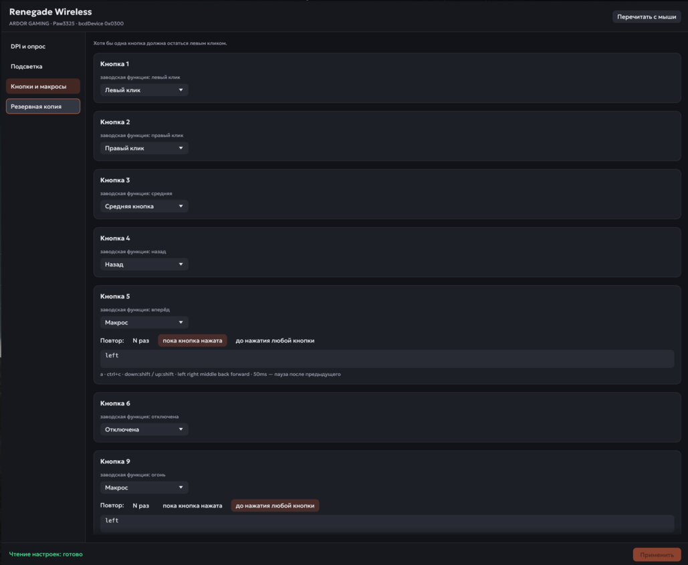

<div align="center">

# Renegade Wireless для Linux

Настройка мыши **ARDOR GAMING Renegade Wireless** без Windows: консольная утилита и графическое приложение.

[](https://github.com/Gidrex/renegade-wireless-linux/actions/workflows/ci.yml)
[](https://github.com/Gidrex/renegade-wireless-linux/releases)
[](LICENSE)



</div>

Заменяет фирменную программу `OemDrv.exe` из `Renegade_Wireless_Software_SETUP_v3.1`. Протокол восстановлен по её дизассемблеру и проверен на реальной мыши. Настройки пишутся в память самой мыши и сохраняются после переподключения и на других компьютерах.

## Возможности

| | CLI `renegade` | GUI `renegade-gui` |
|---|---|---|
| Просмотр всех настроек | `show` | все вкладки |
| Частота опроса 125–1000 Гц | `polling` | DPI и опрос |
| До 8 уровней DPI и их цвета | `dpi`, `dpi-color` | DPI и опрос |
| Подсветка логотипа и DPI-индикатора | `logo`, `dpi-led` | Подсветка |
| Переназначение кнопок: мышь, DPI, клавиши, серии кликов | `button` | Кнопки и макросы |
| Макросы с паузами и повтором | `macro` | Кнопки и макросы |
| Резервная копия памяти мыши и восстановление | `backup`, `restore` | Резервная копия |

Обе программы умеют одно и то же: GUI — это оболочка над тем же кодом, что и CLI.

## Установка

### Готовые бинарники

Скачайте архив `renegade-vX.Y.Z-x86_64-linux.tar.gz` со страницы [Releases](https://github.com/Gidrex/renegade-wireless-linux/releases) и распакуйте. Внутри `renegade`, `renegade-gui` и правило udev.

### Из исходников

```sh
git clone https://github.com/Gidrex/renegade-wireless-linux
cd renegade-wireless-linux
cargo build --release        # target/release/renegade и target/release/renegade-gui
```

Нужен актуальный stable Rust (`rustup update`).

### Доступ без root

Утилите нужен доступ к `/dev/hidraw*` приёмника (`25a7:fa4a`):

```sh
sudo cp 70-renegade.rules /etc/udev/rules.d/
sudo udevadm control --reload && sudo udevadm trigger
```

## Использование

> Беспроводная мышь засыпает через несколько секунд без движения. Если появилось «мышь спит», подвигайте её, и команда продолжится сама (ожидание до 30 с).

Перед экспериментами сохраните резервную копию:

```sh
renegade backup ~/renegade-backup.bin      # restore ~/renegade-backup.bin вернёт всё как было
```

### Основное

```sh
renegade show                              # все текущие настройки
renegade polling 1000                      # 125 | 250 | 500 | 1000 Гц
renegade dpi 800 1600 3200                 # цикл из трёх уровней
renegade dpi-color 1 ff0000                # цвет первого уровня
renegade logo breathing brightness=10 speed=3
renegade dpi-led static color=00a29a brightness=5
```

Диапазон DPI зависит от сенсора, его показывает `show`. PAW3325: 200–5000 с шагом 100 и 5200–10000 с шагом 200. PAW3335: 100–16000 с шагом 100.

### Кнопки

```sh
renegade button 4 key:ctrl+c               # сочетание клавиш
renegade button 5 forward
renegade button 6 click:50:3               # серия из 3 кликов
```

Действия: `left right middle back forward dpi-up dpi-down dpi-cycle off double-click triple-click click:<интервал>:<кол-во> key:<сочетание> raw:XXYYZZ`.

В `key:` можно указать модификаторы `ctrl shift alt win` и до трёх клавиш: `a`–`z`, `0`–`9`, `f1`–`f12`, `enter esc tab space backspace delete insert home end pageup pagedown leftarrow rightarrow uparrow downarrow printscreen capslock`, а также знаки (`minus equal comma dot slash …`).

Хотя бы одна кнопка всегда остаётся левым кликом: утилита не даст отключить его на всех.

### Макросы

```sh
renegade macro 6 1 ctrl+a 20ms ctrl+c      # выделить всё и скопировать, один раз
renegade macro 5 hold left 30ms            # автокликер, пока кнопка нажата
renegade macro 9 until-press down:shift w  # держать shift+w до нажатия любой кнопки
```

- **Повтор:** `1`–`253` раз, `hold` (пока кнопка нажата) или `until-press` (до нажатия любой кнопки).
- **События:**
  - `a`, `ctrl+c` — нажать по порядку, отпустить в обратном;
  - `down:x` / `up:x` — отдельно нажать или отпустить;
  - `left right middle back forward` — кнопки мыши;
  - `rctrl rshift ralt` — правые модификаторы.
- **Паузы:** `50ms` — пауза после предыдущего события. По умолчанию 3 мс, это минимум.
- **Длина:** до 69 нажатий и отпусканий.

## Как это работает

Приёмник отдаёт вендорную HID-коллекцию. Команды уходят feature-репортом `0x08`, ответы приходят input-репортом `0x09`. Мышь хранит настройки в памяти размером около 7 КБ, у каждого поля есть контрольный байт. Подробности: карта памяти, кодировки, как добавить функцию, как тестировать на железе — в [docs/DEVELOPMENT.md](docs/DEVELOPMENT.md).

## Ограничения

- Проверено на Renegade Wireless с приёмником `25a7:fa4a` и сенсором PAW3325. PAW3335 (`bcdDevice 0x1xxx`) поддержан по таблицам Windows-программы, но на железе не проверялся.
- Названия режимов подсветки (`static`, `breathing`, `neon`) и смысл параметров `brightness`/`speed` взяты из порядка пунктов в Windows-программе. Байты пишутся точно, но эффект стоит проверить глазами.
- Не реализованы мультимедиа-клавиши и показ заряда батареи.

## Лицензия

Код — [MIT](LICENSE). Шрифт Geologica — [SIL Open Font License 1.1](assets/fonts/OFL.txt).

Проект не связан с ARDOR GAMING. Названия принадлежат их владельцам.
